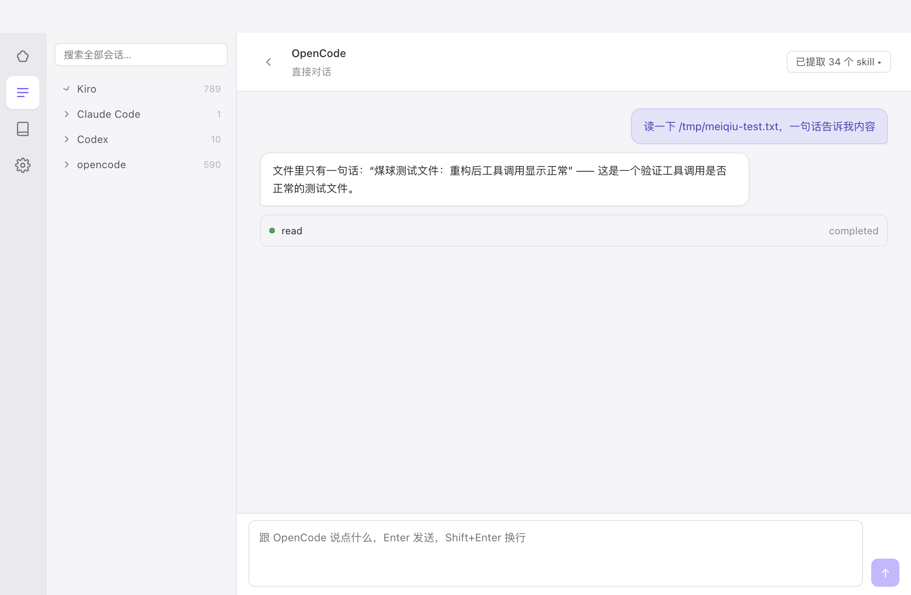
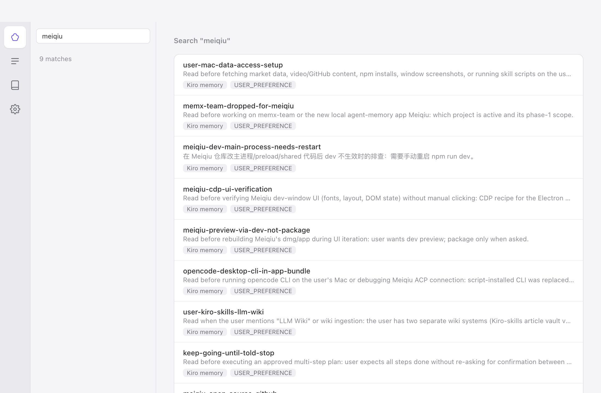
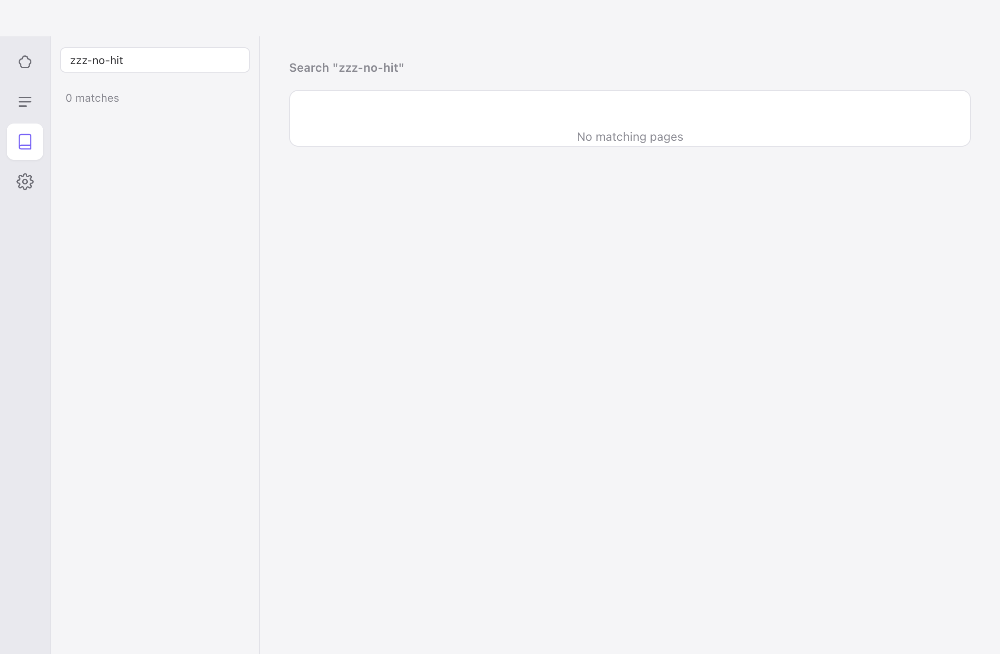
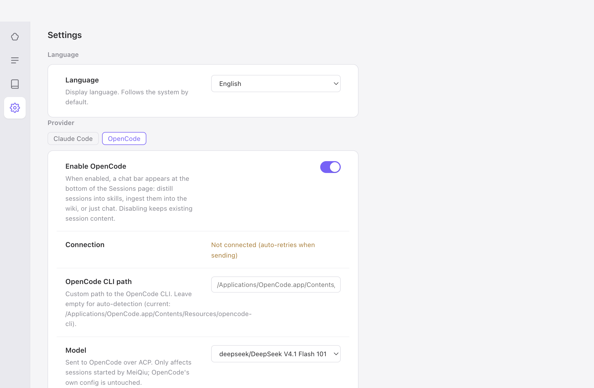

# MeiQiu

English | [中文](README.zh-CN.md)

A macOS desktop app that puts all your AI coding agents' memories, sessions, and a personal knowledge wiki in one place.

It works with the agents you already use — **Kiro**, **Claude Code**, **Codex**, and **opencode** — reading their data files directly (read-only). Your data never leaves your machine.



## Features

**Memories — one viewer for every agent's memory**
- Browse memories, steering/rules files (`CLAUDE.md`, `AGENTS.md`, Kiro steering) across all four agents, grouped by agent and scope (global / per-project), with keyword search.
- Always read-only: SQLite databases are opened in read-only mode, and the app never writes to your agents' files.
- Live refresh: file watchers pick up external changes while the app is open.



**Sessions — browse and search conversation history**
- All agents' sessions in one tree (agent → project), including Kiro IDE + kiro-cli, Claude Code, Codex rollouts, and opencode.
- Full conversation view with message bubbles.

**Embedded chat via ACP (Agent Client Protocol)**
- Chat with Claude Code or OpenCode inside the app, with tool calls shown inline.
- Ask questions about any session — the app attaches the session file as context.

**Skill extraction — distill sessions into reusable skills**
- One click pre-fills an instruction for the agent to distill a session's workflow into a skill (using the bundled [skill-creator](resources/skill-creator)), saved to `~/.claude/skills/`. You review and send; nothing runs automatically.

**Personal wiki — your knowledge, distilled from sessions**
- Ingest any session into a plain-markdown wiki vault (`~/.meiqiu/vault/`): source pages with evidence anchors, entity/concept/analysis pages, cross-links.
- Safety rails: the vault is backed up before every ingest, programmatic checks run after (frontmatter, links, evidence hashes), and a report with one-click rollback is shown when done.
- Full-text search (SQLite FTS5 trigram, works with Chinese) and programmatic lint (broken links, orphan pages, stale evidence).



**Bilingual UI** — 中文 / English, switchable in Settings.



## Install

Download the `.dmg` from [Releases](../../releases). macOS only (Apple Silicon and Intel).

The app is not signed with an Apple Developer certificate yet, so on first launch macOS will block it: right-click the app → **Open** → **Open** in the dialog, or go to **System Settings → Privacy & Security** and click **Open Anyway**.

## Build from source

Requires Node.js 22+.

```bash
npm install
npm run dev        # development with hot reload
npm run build:mac  # produces dist/meiqiu-<version>.dmg
```

If the npm registry is slow in your region:

```bash
ELECTRON_MIRROR=https://npmmirror.com/mirrors/electron/ \
ELECTRON_BUILDER_BINARIES_MIRROR=https://npmmirror.com/mirrors/electron-builder-binaries/ \
npm install --registry=https://registry.npmmirror.com
```

## Tech stack

Electron + React + TypeScript, with `node:sqlite` (no native modules to rebuild), [electron-vite](https://electron-vite.org), and the ACP adapter [@agentclientprotocol/claude-agent-acp](https://www.npmjs.com/package/@agentclientprotocol/claude-agent-acp). Wiki pages are plain markdown files — the app's own SQLite only stores rebuildable indexes and reports.

## Privacy

Everything stays on your machine. MeiQiu reads your agents' memory and session files (read-only), and keeps its own data (settings, wiki vault, backups, indexes) under `~/.meiqiu/`. There is no telemetry and no network upload.

## Background

MeiQiu was vibe-coded — built iteratively with AI agents (mostly Kiro and Claude Code) doing the typing. It started as several small utility scripts I kept reaching for at work (reading Kiro's memory DB, digging through Claude Code session files, freezing session transcripts for distillation), which eventually merged into one app. The design and architecture decisions are human; a lot of the code is agent-written and human-reviewed.

## What's next (tentative)

- Edit & delete memories (currently read-only), with backup-before-write.
- An MCP server so any agent can search your wiki and cross-agent memories as context.
- Optional, selective session upload (agent-memory client).

No promises on order or dates — this is a personal project.

## License

[MIT](LICENSE)
