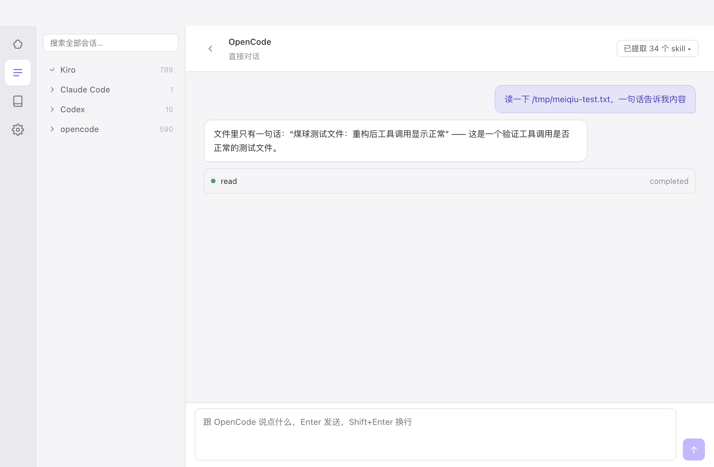
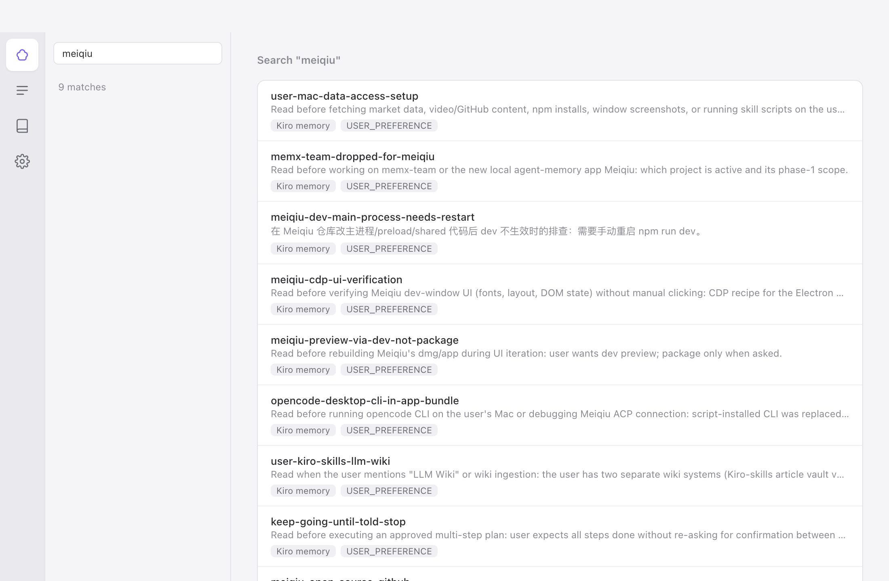
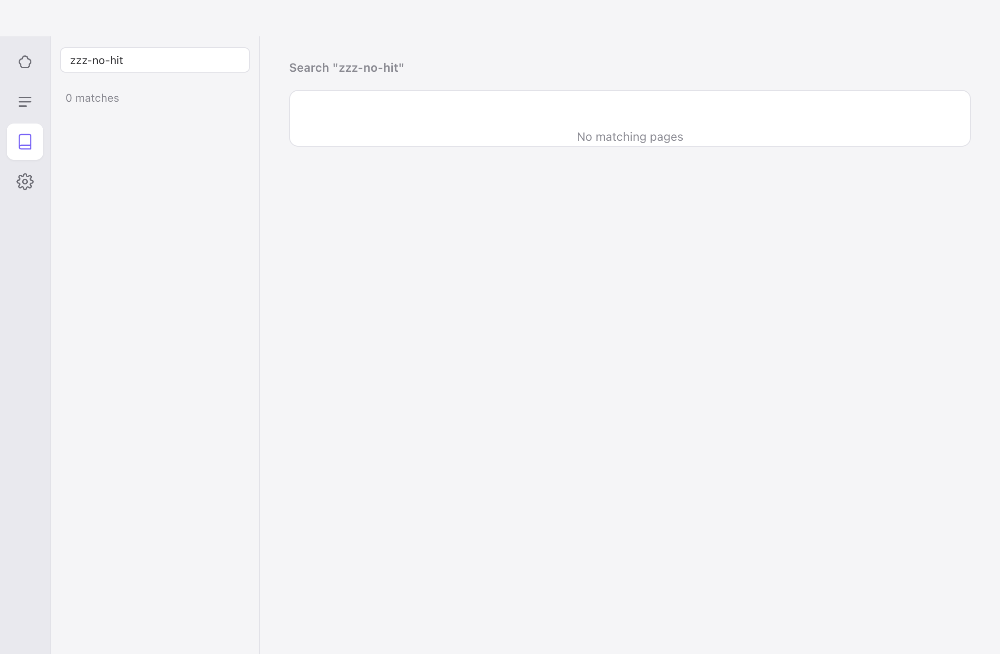
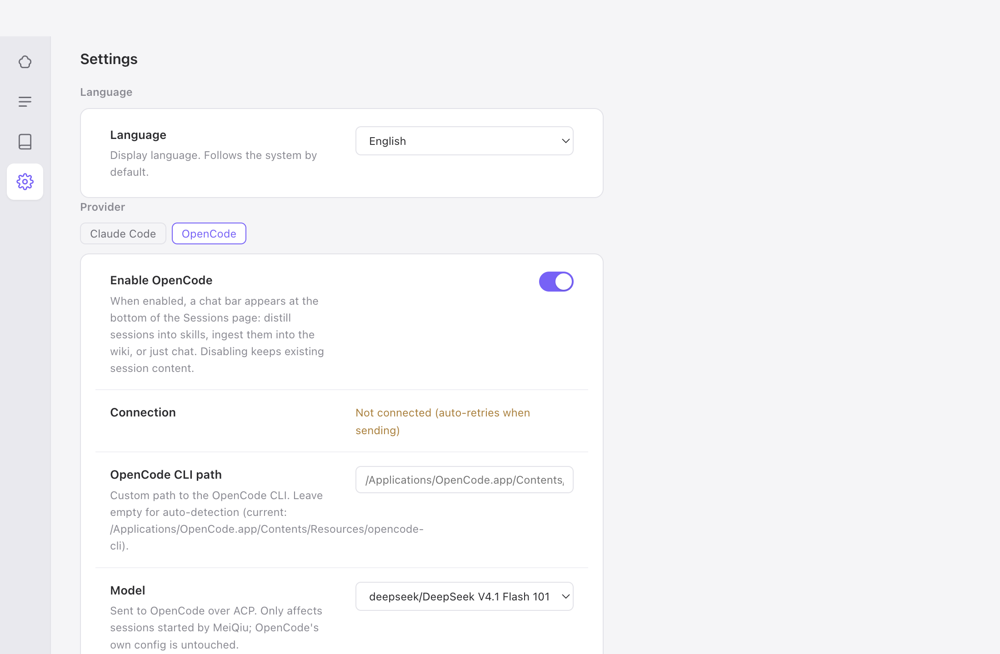

# MeiQiu

[English](README.md) | 中文

一个 macOS 桌面 app，把你所有 AI 编程 agent 的记忆、会话和个人知识库放进同一个界面。

它配合你已经在用的 agent——**Kiro**、**Claude Code**、**Codex**、**opencode**——直接读它们的数据文件（一律只读）。数据不出本机。



## 功能

**记忆——各家 agent 记忆的统一查看器**
- 浏览四家 agent 的记忆和规则文件（`CLAUDE.md`、`AGENTS.md`、Kiro steering），按 agent 和范围（全局 / 按项目）分组，支持关键词搜索。
- 永远只读：SQLite 一律只读模式打开，app 不往任何 agent 的文件里写东西。
- 自动刷新：app 打开期间，agent 在外部改了记忆，文件监听会自动更新列表。



**会话——浏览和搜索历史对话**
- 所有 agent 的会话统一成一棵树（agent → 项目），覆盖 Kiro IDE 和 kiro-cli、Claude Code、Codex rollout、opencode。
- 对话内容气泡视图。

**内嵌聊天（走 ACP 协议）**
- 在 app 里直接和 Claude Code / OpenCode 对话，工具调用过程内联展示。
- 看会话时发问，app 自动把这个会话的文件带上作为上下文。

**提取 skill——把会话提炼成可复用的 skill**
- 一键预填指令，让 agent 按内置的 [skill-creator](resources/skill-creator) 把会话里可复用的做事流程提炼成 skill，保存到 `~/.claude/skills/`。指令由你检查、修改后自己发送，不会自动执行。

**个人知识库——从会话提炼的知识**
- 把任何会话摄入纯 markdown 的知识库（`~/.meiqiu/vault/`）：带来源证据锚点的 source 页，实体/概念/分析页，交叉链接。
- 安全机制：每次摄入前自动备份 vault，摄入后跑程序校验（frontmatter、链接、证据 hash），出报告，出错可一键回滚。
- 全文搜索（SQLite FTS5 trigram，支持中文）和程序体检（断链、孤立页、证据失效）。



**中英双语界面**——设置页可切换。



## 安装

从 [Releases](../../releases) 下载 `.dmg`。仅支持 macOS（Apple Silicon 和 Intel 都可以）。

app 还没有 Apple 开发者证书签名，首次打开会被 macOS 拦：右键点 app 图标 → **打开** → 弹窗里再点**打开**；或者去「系统设置 → 隐私与安全性」点「仍要打开」。

## 从源码构建

需要 Node.js 22+。

```bash
npm install
npm run dev        # 开发模式，热更新
npm run build:mac  # 产出 dist/meiqiu-<版本号>.dmg
```

npm 官方源慢的话用镜像：

```bash
ELECTRON_MIRROR=https://npmmirror.com/mirrors/electron/ \
ELECTRON_BUILDER_BINARIES_MIRROR=https://npmmirror.com/mirrors/electron-builder-binaries/ \
npm install --registry=https://registry.npmmirror.com
```

## 技术栈

Electron + React + TypeScript，SQLite 用 Node 自带的 `node:sqlite`（没有需要重编译的原生模块），构建用 [electron-vite](https://electron-vite.org)，ACP 适配器是 [@agentclientprotocol/claude-agent-acp](https://www.npmjs.com/package/@agentclientprotocol/claude-agent-acp)。wiki 页面是纯 markdown 文件——app 自己的 SQLite 只存可重建的索引和报告。

## 隐私

一切数据留在本机。MeiQiu 只读各家 agent 的记忆和会话文件，自己的数据（设置、知识库、备份、索引）放在 `~/.meiqiu/`。没有遥测，没有网络上传。

## 背景

MeiQiu 是 vibe coding 写出来的——迭代过程中主要由 AI agent（Kiro 和 Claude Code）动手写码。**它最初是工作中积累的几个常用小脚本（读 Kiro 的记忆库、翻 Claude Code 的会话文件、冻结会话转写用于提炼）**，后来合并成了一个 app。设计和架构决策是人做的，大量代码是 agent 写、人审的。

## 后续（暂定）

近期：

- 记忆的修改和删除（目前是只读），写之前先备份。
- MCP server：让任何 agent 都能检索你的知识库和跨 agent 记忆，作为上下文。
- agent memory：可选的、选择性的会话上传客户端。

长期方向是 agent 工程——不自己造 harness，在各家成熟 harness 之上做：

- superagent：一个入口调度多家 agent。
- loop engineering：agent 循环的编排和观测。
- graph engineering：agent 工作流图。

个人项目，不承诺顺序和时间。

## License

[MIT](LICENSE)
